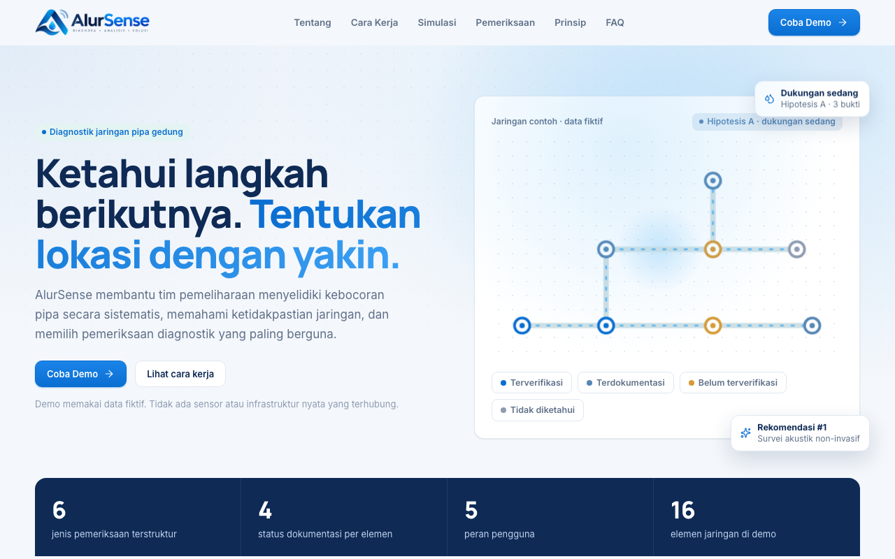
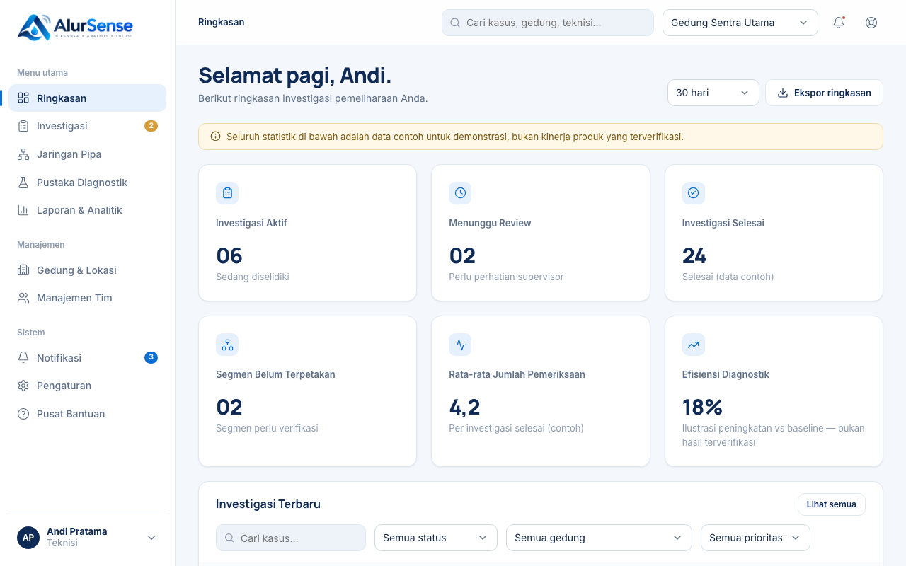
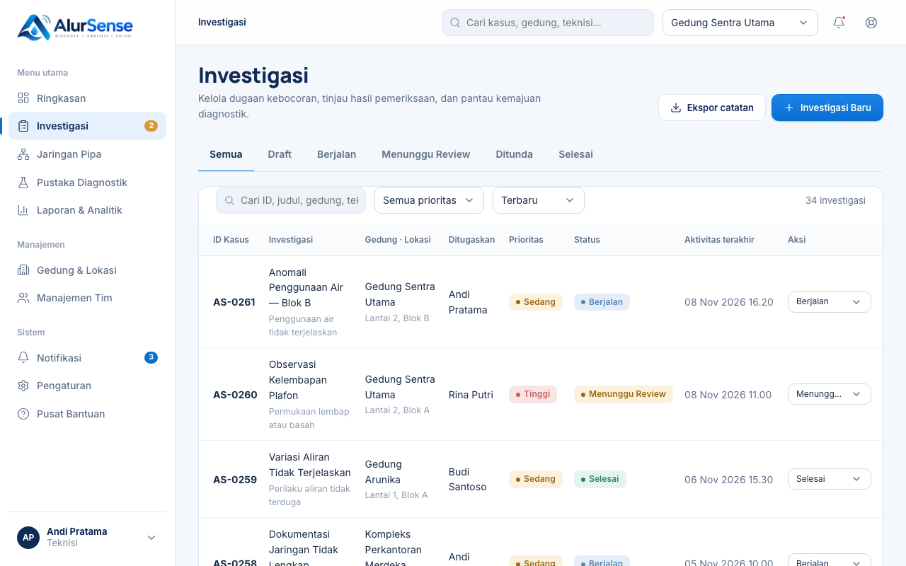
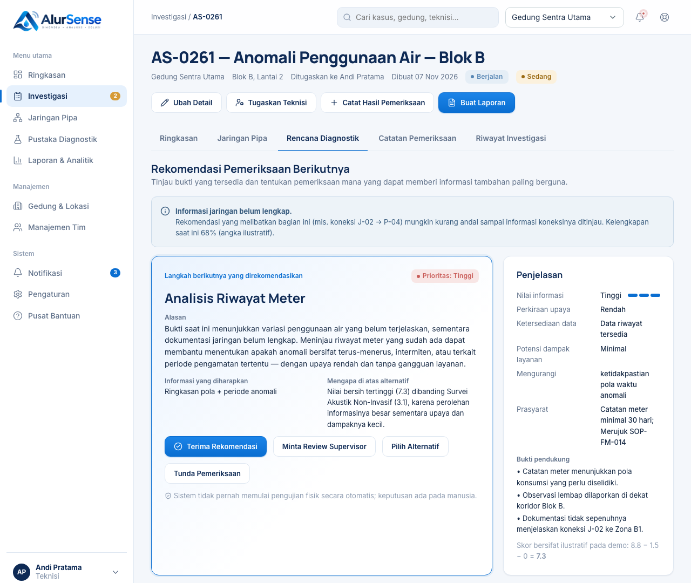
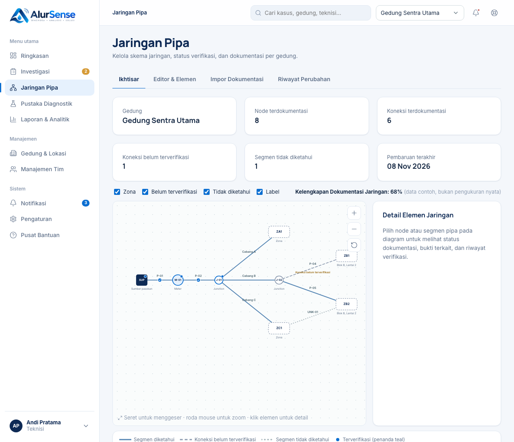
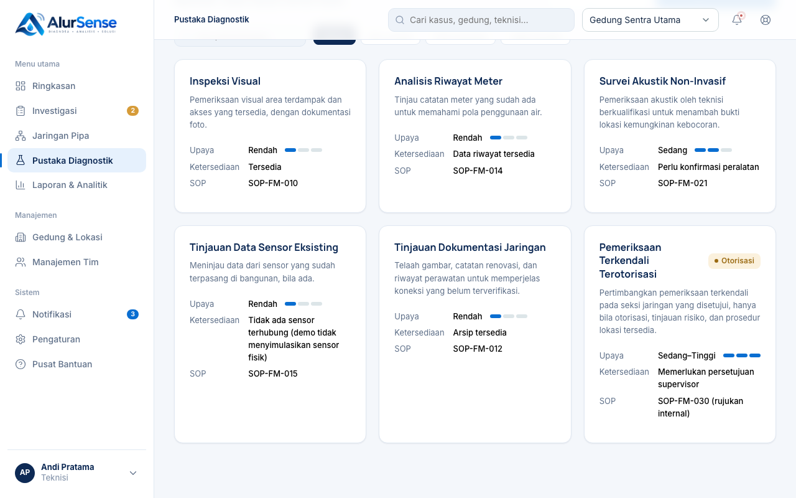
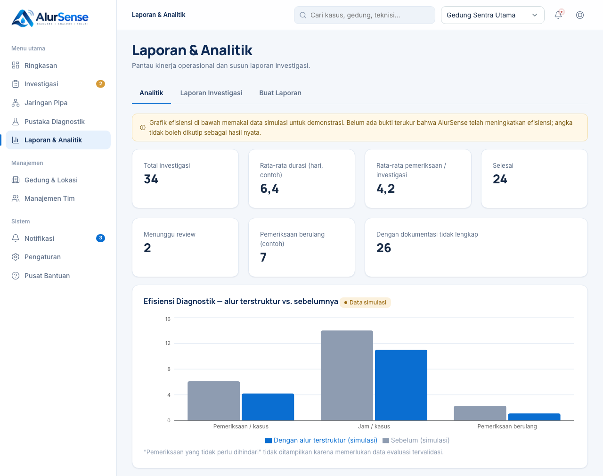
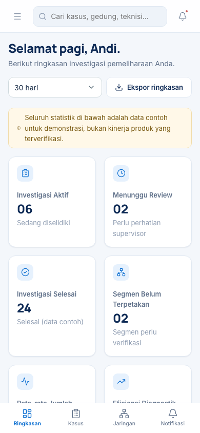
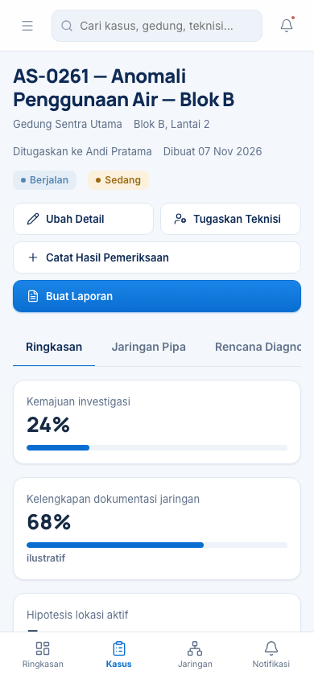

<div align="center">


### Ketahui langkah berikutnya. Tentukan lokasi dengan yakin.

Platform diagnostik jaringan pipa gedung: investigasi kebocoran yang sistematis,
transparan soal ketidakpastian, dan selalu menyerahkan keputusan akhir kepada manusia.


-D69B38)


</div>

<p align="center">
  
</p>

---

## Tentang AlurSense

Mencari sumber kebocoran di jaringan pipa gedung sering berujung pada tebak-tebakan: gambar pipa usang, pola pemakaian air yang misterius, dan banyak dugaan lokasi. **AlurSense** membantu tim pemeliharaan mengubah proses itu menjadi investigasi terstruktur:

1. **Petakan jaringan** dan tandai bagian mana yang sudah terverifikasi, belum terverifikasi, atau tidak diketahui.
2. **Buka investigasi** lengkap dengan bukti, gejala, dan hipotesis lokasi yang saling bersaing.
3. **Pilih pemeriksaan berikutnya** berdasarkan rekomendasi yang bisa dijelaskan, bukan sekadar insting.
4. **Review & dokumentasikan** hasilnya dalam laporan yang siap dicetak.

> **Prinsip desain.** AlurSense tidak pernah memulai pengujian fisik secara otomatis, tidak pernah menyatakan lokasi kebocoran sebagai "terkonfirmasi" tanpa bukti, dan selalu menampilkan ketidakpastian. Rekomendasi bersifat penjelasan informatif, bukan diagnosis.

> **Catatan demo.** Seluruh data di aplikasi ini fiktif. Tidak ada sensor atau infrastruktur nyata yang terhubung, dan semua angka efisiensi adalah ilustrasi, bukan hasil pengukuran.

---

## Fitur Utama

### Ringkasan operasional
Dasbor menampilkan investigasi aktif, kasus yang menunggu review, segmen jaringan yang belum terpetakan, serta daftar investigasi terbaru yang bisa difilter. Ada juga panel *Perlu Perhatian Anda*, aktivitas terkini, dan grafik tren.

<p align="center">
  
</p>

### Manajemen investigasi
Buat investigasi lewat wizard 5 langkah dengan validasi, lalu kelola status (*Draft → Berjalan → Menunggu Review → Ditunda → Selesai*), prioritas, dan penugasan teknisi. Pencarian dan filter bekerja langsung pada daftar.

<p align="center">
  
</p>

### Ruang kerja kasus
Setiap kasus punya ruang kerja sendiri: ringkasan kondisi dan bukti, peta jaringan, rencana diagnostik, catatan pemeriksaan, dan riwayat investigasi lengkap dengan lini masa.

<p align="center">
  
</p>

### Rekomendasi pemeriksaan yang bisa dijelaskan
Mesin rekomendasi menilai tiap pemeriksaan dengan model transparan:

```
Nilai = Perkiraan Perolehan Informasi − Penalti Upaya − Penalti Dampak Operasional
```

Hasilnya berupa peringkat, perbandingan antaropsi, dan bagian **"Mengapa rekomendasi ini?"** yang menjabarkan ketidakpastian waktu, topologi, dan lokasi. Pengguna bisa menerima rekomendasi, meminta review supervisor, memilih alternatif, atau menunda. Model ini ilustratif, bukan rumus rekayasa tervalidasi.

<p align="center">
  
</p>

### Peta jaringan pipa interaktif
Diagram skematik dengan geser, zoom, dan lapisan yang bisa dinyalakan atau dimatikan. Setiap elemen punya status dokumentasi (terverifikasi, terdokumentasi, belum terverifikasi, tidak diketahui). Tersedia editor elemen, impor dokumentasi, dan riwayat perubahan.

<p align="center">
  
</p>

### Pustaka diagnostik
Katalog enam jenis pemeriksaan, dari inspeksi visual sampai pemeriksaan terkendali yang memerlukan otorisasi. Tiap entri memuat tujuan, tingkat upaya, ketersediaan, dan rujukan SOP.

<p align="center">
  
</p>

### Laporan & analitik
Pantau metrik operasional, lihat laporan per investigasi, dan susun laporan yang bisa dicetak atau disimpan sebagai PDF.

<p align="center">
  
</p>

### Responsif di ponsel
Antarmuka menyesuaikan diri untuk teknisi di lapangan, dengan navigasi bawah dan target sentuh yang nyaman.

<p align="center">
  
  &nbsp;&nbsp;&nbsp;
  
</p>

### Lainnya
- **Peran & persetujuan**: lima peran (Teknisi, Supervisor, Maintenance Manager, Administrator, Viewer). Persetujuan hasil dan rencana hanya untuk Supervisor, Maintenance Manager, dan Administrator.
- **Manajemen tim**: undang, ubah peran, dan nonaktifkan pengguna (Administrator).
- **Gedung & lokasi**, **notifikasi**, **pengaturan**, dan **pusat bantuan**.

---

## Teknologi

| Lapisan | Pilihan |
| --- | --- |
| UI | React 19, TypeScript |
| Routing | React Router (HashRouter) |
| Grafik | Recharts |
| Ikon | Lucide React |
| Build | Vite |
| Penyimpanan | `localStorage` di peramban (tanpa backend) |

---

## Menjalankan secara lokal

Prasyarat: [Node.js](https://nodejs.org) 22 atau lebih baru.

```bash
# 1. Pasang dependensi
npm install

# 2. Jalankan mode pengembangan
npm run dev
```

Buka alamat yang ditampilkan (biasanya `http://localhost:5173`). Kredensial login sudah terisi otomatis karena ini mode demo.

| Perintah | Fungsi |
| --- | --- |
| `npm run dev` | Server pengembangan |
| `npm run build` | Cek tipe TypeScript lalu build produksi ke `dist/` |
| `npm run preview` | Pratinjau hasil build |
| `npm test` | Tes mesin rekomendasi |

Data demo dapat dikembalikan lewat menu profil → **Reset data demo**.

---

## Struktur proyek

```
src/
├── App.tsx          # Rute dan tata letak aplikasi
├── engine.ts        # Mesin rekomendasi (transparan, ilustratif)
├── engine.test.ts   # Tes mesin
├── data.ts          # Data demo fiktif dan definisi tipe
├── store.tsx        # State global dan persistensi
├── ui.tsx           # Komponen UI bersama
└── pages/           # Halaman: Dashboard, Investigations, Workspace, Networks, ...
public/              # Logo dan favicon
docs/screenshots/    # Tangkapan layar untuk README
```

---

## Author & License

Created by Vassel Goleyu. Copyright (c) 2026 Vassel Goleyu. All rights reserved.

Kode sumber ini dipublikasikan agar dapat dilihat. Penggunaan, penyalinan, modifikasi, atau distribusi memerlukan izin tertulis dari pemiliknya. Lihat [LICENSE](LICENSE).
